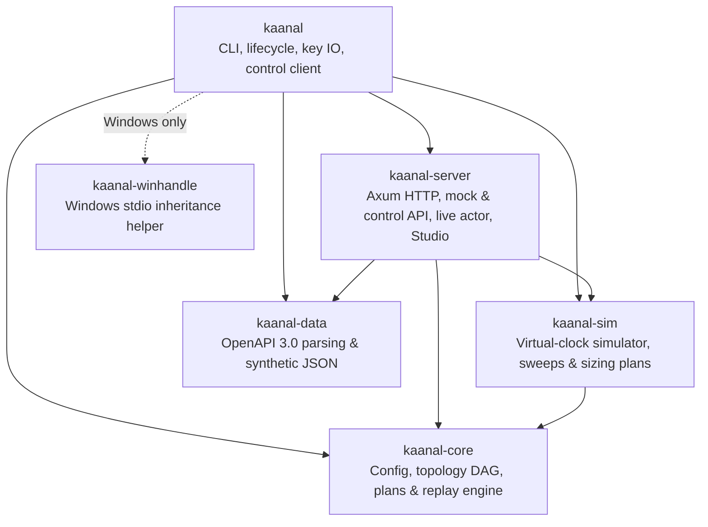

# Kaanal Architecture

Kaanal (கானல்) is a single-binary backend emulator. One HTTP listener serves both OpenAPI-driven mock routes and the `/__kaanal/*` control plane, while a pure deterministic core models topology latency, capacity, and failures.

## Workspace Crates

The workspace is split into six crates with strict one-way dependencies:

| Crate              | Role                                                                                                                             | Boundary                                                                                |
| ------------------ | -------------------------------------------------------------------------------------------------------------------------------- | --------------------------------------------------------------------------------------- |
| `kaanal-core`      | Config parsing, `Located` diagnostics, topology DAG, call-chain compiler, deterministic sampling, and `replay::Engine`.          | Pure logic only: no `tokio`, no `axum`, no IO, no wall-clock time.                      |
| `kaanal-data`      | OpenAPI 3.0 `$ref` inlining, locale packs, data dictionaries, pagination, and deterministic JSON generation.                     | Independent of `kaanal-core`; no HTTP or async.                                         |
| `kaanal-sim`       | Discrete-event virtual-clock simulator, traffic summaries, load sweeps, and cloud sizing/pricing plans.                          | Depends only on `kaanal-core`; shares its exact cost and replay model.                  |
| `kaanal-server`    | Axum router, security `guard`, mock handler, control API, live replay actor, SSE bus, RS256 auth, and embedded Studio/status UI. | Only crate that serves HTTP.                                                            |
| `kaanal`           | `clap` CLI, `.kaanal/lock` & `.kaanal/run.json` lifecycle, signing key IO, and thin `ureq` control client.                       | Thin client over `/__kaanal/*`; no duplicated business logic.                           |
| `kaanal-winhandle` | Marks std handles non-inheritable around detached `kaanal up -d` spawns on Windows.                                              | Isolates the workspace's sole `unsafe` call (`unsafe_code = "forbid"` everywhere else). |

## Core Invariants

- **One Binary, One Port**: Mock routes and `/__kaanal/*` control endpoints share a single TCP listener.
- **One Model, Two Clocks**: `kaanal-core` samples a request `Plan` and replays it through `replay::Engine` (slots, FIFO/bounded queues, rate limits, retries, circuit breakers). `kaanal-server` drives it on a real-time actor clock; `kaanal-sim` drives it on a virtual clock.
- **Deterministic by Construction**: Unconditional RNG draws for chaos and per-hop/per-field `stable_hash` seeds keep timings and response bodies repeatable for a given `seed`.
- **Fail Fast and Loud**: Invalid YAML, cyclic topologies, and bad OpenAPI schemas fail at load time with `file:line:col` diagnostics; draft applies validate before swapping active state.
- **Localhost Defense-in-Depth**: Control routes enforce loopback `Host` checks, constant-time 256-bit Bearer tokens, and strict CSP without CORS writes.

## Full Documentation

For the complete architectural deep dive — including topology validation rules, latency distributions, replay mechanics, chaos layering, data synthesis seeding, security guard details, process lifecycle, and 3 AM failure modes — see [`docs/source/architecture.md`](docs/source/architecture.md).

For per-file source walkthroughs, see [`docs/source/files/index.md`](docs/source/files/index.md).
