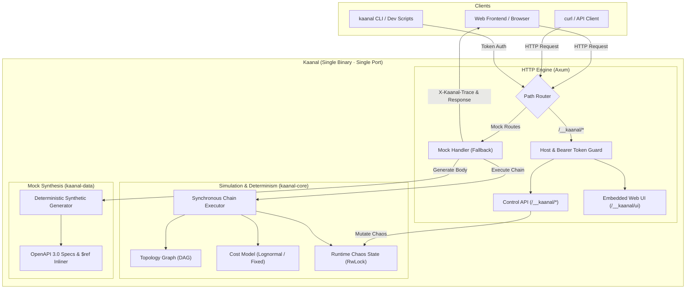

# Kaanal

_Kaanal_ (கானல், Tamil for "mirage") is a single binary that pretends to be your backend: OpenAPI mocks with realistic data, simulated gateway → service → database timing, and live chaos.

Status: Phase One (pre-release). Site: [https://kaanal.naveenr.in](https://kaanal.naveenr.in)



---

## Why Kaanal?

When developing frontends, mobile apps, or microservices:

1. **Backends are late, incomplete, or unstable**: Waiting for services blocks UI and integration work.
2. **Traditional mock servers return instantly (0 ms)**: Instant responses hide loading states, race conditions, spinners, and latency bugs.
3. **Failures are hard to test on demand**: Taking down a real database or simulating a 504 gateway timeout is cumbersome.
4. **Mock data looks fake**: Seeing `"string"` and `0` in every field makes UI layouts meaningless.

Kaanal solves this with a **single YAML topology file** and an **OpenAPI 3.0 specification**:

- Serves realistic, coherent synthetic JSON (names, emails, phones, addresses, dates).
- Simulates multi-hop latency (`gateway.proc` + `network` + `service.proc` + `database.op`).
- Injects live chaos (latency, error rates, node down) via CLI, HTTP API, or an embedded Web UI.
- Remains **100% deterministic** for a given seed — tests run reproducibly on CI and local workstations.

---

## Try it

Needs Rust 1.99 or newer.

```bash
cargo run -p kaanal -- up -c examples/nginx-server/kaanal.yaml
```

`kaanal up` binds to `127.0.0.1:8080` (or the next free port up to 8100) and prints:

```text
Mocks: http://localhost:8080
UI:    http://localhost:8080/__kaanal/ui#token=<64-character hex token>
```

### 1. Test a mock request

In a second terminal:

```bash
curl -i http://localhost:8080/users/42
```

```http
HTTP/1.1 200 OK
content-type: application/json
x-kaanal-trace: nginx.proc=0.6ms,net=0.9ms,app.proc=3.0ms,net=1.1ms,db.read=2.7ms
access-control-allow-origin: *
access-control-expose-headers: x-kaanal-trace

{"city":"Coimbatore","createdAt":"2025-10-31T00:15:04Z","email":"karthik.bose67@example.com","firstName":"Karthik","id":42,"lastName":"Bose","phone":"+91 9695550062","pincode":"641001","state":"Tamil Nadu","status":"active"}
```

(Some CORS and standard headers trimmed.)

Notice:

- `id: 42` was copied from the URL path parameter into the matching schema field.
- City, state, and pincode describe a consistent, real place; the name and email belong to the same person.
- The `X-Kaanal-Trace` header reports the exact latency breakdown across simulated nodes.
- Your client actually waited the sum of the trace, ~8.3 ms.

### 2. Inject live chaos

```bash
# Force the database node to fail with 503
cargo run -p kaanal -- chaos set db --error-rate 100% --error 503

# Next request fails at the database hop after gateway and service latency
curl -i http://localhost:8080/users/42

# Check status of the running instance
cargo run -p kaanal -- status

# Clear chaos back to normal
cargo run -p kaanal -- chaos clear
```

### 3. Run automated verification

To test stable responses, trace headers, chaos 503, and automatic recovery in one script:

```bash
bash examples/nginx-server/check.sh      # or: pwsh examples/nginx-server/check.ps1
```

---

## Configuration (`kaanal.yaml`)

```yaml
version: 1
seed: 42                 # Master seed: same seed -> identical data and timings
port: 8080

nodes:
  nginx: { type: gateway, flavor: nginx, proc: 1ms }
  app:   { type: service, spec: openapi.yaml, proc: 5ms }
  db:    { type: database, flavor: postgres,
           ops: { read: { p50: 4ms, p99: 20ms }, write: 8ms, scan: 30ms } }

edges:
  - { from: nginx, to: app, net: 1ms }
  - { from: app, to: db, net: 1ms }

routes:                  # Optional static overrides
  "GET /health": { body: { ok: true } }
  "GET /users":  { body: [ { id: 1 } ], status: 200 }
```

- **`nodes`**:
  - `gateway`: Exactly one entry point per topology.
  - `service`: Backend microservice hosting an OpenAPI 3.0 `spec`.
  - `database`: Data store with configured costs for `read`, `write`, and `scan` operations. Costs can be fixed (`5ms`) or fitted lognormal percentiles (`{ p50: 4ms, p99: 20ms }`).
- **`edges`**: Directed dependency graph. In Phase One, requests flow `gateway -> service -> database`.
- **`routes`**: Static route overrides that take precedence over generated OpenAPI schemas.

Check configs without starting:

```bash
cargo run -p kaanal -- validate -c kaanal.yaml
```

---

## CLI Reference

All CLI commands run from the project directory where `kaanal up` was executed:

| Command                                             | Description                                                                    |
| --------------------------------------------------- | ------------------------------------------------------------------------------ |
| `kaanal up [-c config] [--port port] [--host host]` | Start the mock server in foreground.                                           |
| `kaanal validate [-c config]`                       | Validate topology, YAML syntax, and OpenAPI specs.                             |
| `kaanal status`                                     | Show running nodes and active chaos settings.                                  |
| `kaanal chaos set <node> [flags]`                   | Modify chaos (`--latency 300ms`, `--error-rate 10%`, `--error 503`, `--down`). |
| `kaanal chaos clear [node]`                         | Clear chaos on one node or all nodes.                                          |

Exit codes: `0` (success), `1` (error), `2` (no running instance found).

---

## Security & Architecture Principles

- **Local Development Security**: Binds to `127.0.0.1` by default. Control endpoints require a 256-bit Bearer token and check the `Host` header against DNS-rebinding attacks.
- **Strict File Isolation**: Holds an exclusive OS lock on `.kaanal/lock` using `std::fs::File::try_lock` ensuring exactly one instance per directory. `.kaanal/run.json` is protected with private permissions (Unix `0700`/`0600`, Windows ACLs restricted to the current user SID).
- **Synthetic Data Safety**: All emails use `@example.com` (RFC 2606); no real user data is ever generated or queried.
- **Embedded Web UI**: Self-contained vanilla HTML/JS served at `/__kaanal/ui` with strict Content Security Policy (`frame-ancestors 'none'`, `no-referrer`, DOM manipulation via `textContent` only).

---

## Documentation

Full documentation is located in the [`docs/`](docs/) directory:

- [Architecture Overview](docs/source/architecture.md) — System decomposition, request flows, determinism model, and threading.
- [How-To Guide](docs/source/how-to.md) — Recipes for building, adding node types, subcommands, and endpoints.
- [Tests Guide](docs/source/tests.md) — Detailed catalog of all workspace integration and unit tests.
- [Per-File Code Reference](docs/source/files/index.md) — Deep walkthrough of every crate source file.
- [User Guide](docs/web/user-guide.md) — End-user operational guide and configuration reference.
- [Control API Reference](docs/web/control-api.md) — HTTP reference for `/__kaanal/*`.
- [Core Concepts](docs/web/concepts.md) — Topology DAGs, cost models, and chaos propagation explained.
- [Web UI Guide](docs/web/web-ui.md) — Live status page features, telemetry counters, and security rules.
- [Contributor Coding Guide](docs/coding-guide/index.md) — Architectural invariants, coding standards, and lint policies.

---

## License

Licensed under the [Apache License, Version 2.0](LICENSE).
