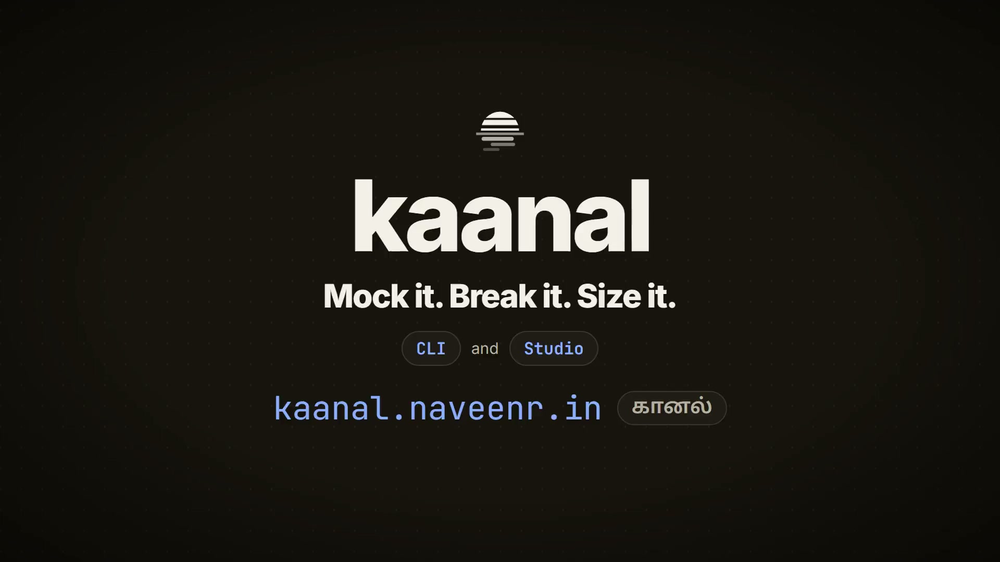

<p align="center">
  <picture>
    <source media="(prefers-color-scheme: dark)" srcset="docs/assets/banner-dark.png">
    <source media="(prefers-color-scheme: light)" srcset="docs/assets/banner-light.png">
    
  </picture>
</p>

# Kaanal

_Kaanal_ (கானல், Tamil for "mirage") is a single binary that pretends to be your backend. It serves OpenAPI 3.0 mocks with coherent synthetic data, models multi-hop topology latency and capacity, and injects live chaos on demand — all from one local port.

[](https://github.com/Naveen2070/kaanal/releases) [](LICENSE) [](https://www.rust-lang.org) [](https://kaanal.naveenr.in/docs/)

> **Status:** v0.1 (first public release; expect changes below 1.0).

[](https://github.com/user-attachments/assets/44fc7003-010f-48d1-b4a0-5718260e8894)

_Want to learn how a system really works? Break it, safely, on your laptop. Kaanal is one binary that pretends to be your backend: mock it, break the database from the CLI or Studio, then size it and see where it gives way. [kaanal.naveenr.in](https://kaanal.naveenr.in)_

## Why Kaanal?

- **Unblock the frontend.** One `kaanal.yaml` plus an OpenAPI 3.0 spec gives you a working backend before the real one exists.
- **Latency you can feel.** Instant mocks hide spinners, races and timeout bugs. Kaanal makes each request wait the simulated time of every hop.
- **Failures on demand.** Take a node down, add tail latency or force a 504 from the CLI, HTTP or Studio.
- **Data that looks real.** Names, emails, phones and addresses stay consistent within a record (`en-IN`, `en-US`, `en-GB`, `de-DE`, `fr-FR`, `es-ES`, `pt-BR`, or your own pack). The same `seed` gives the same data.

## Quick Start

Download a binary for Linux (`x86_64`), macOS (`arm64`), or Windows (`x86_64`) from [GitHub Releases](https://github.com/Naveen2070/kaanal/releases) (verify `SHA256SUMS`) and put `kaanal` on your `PATH`.

```sh
kaanal demo                                   # interactive demo shop with live chaos bar
# or from a repo checkout:
kaanal up -c examples/nginx-server/kaanal.yaml
```

`kaanal up` binds `127.0.0.1:8080` and prints the mock URL and Studio link (`/__kaanal/studio?mode=admin#token=...`; a token-free status page lives at `/__kaanal/ui`).

### Hit a mock route, then break it live

```sh
curl -i http://localhost:8080/users/42
```

```http
HTTP/1.1 200 OK
content-type: application/json
x-kaanal-trace: nginx.proc=0.6ms,net=0.9ms,app.proc=3.0ms,net=1.1ms,db.read=2.7ms
access-control-allow-origin: *
access-control-expose-headers: x-kaanal-trace

{"city":"Kochi","createdAt":"2025-04-02T23:57:31Z","email":"siddharth.rao81@example.com","firstName":"Siddharth","id":42,"lastName":"Rao","phone":"+91 9385785563","pincode":"682001","state":"Kerala","status":"active"}
```

`id: 42` is bound from the URL path, the address and person are coherent, `X-Kaanal-Trace` shows the per-hop breakdown, and your client actually waited ~8.3 ms. Now inject a database outage:

```sh
kaanal chaos set db --error-rate 100% --error 503   # next curl fails at db after gateway + app latency
kaanal status                                      # inspect nodes, effective chaos, active scenarios
kaanal chaos clear                                 # restore normal operation
```

Run `bash examples/nginx-server/check.sh` (or `pwsh examples/nginx-server/check.ps1`) to verify determinism, trace headers, and recovery in one pass.

## Studio, Simulation & Planning

Built-in **Studio** (`/__kaanal/studio`) lets you wire topologies visually, run **Live**, **Batch**, or **Admin** modes (pinning UI states like `loading`, `empty`, `error`, `slow`), sweep load to find the saturation knee, and size topologies across AWS, GCP, and Azure estimates — all backed by the same `kaanal-core` engine as the CLI:

```sh
kaanal sim run -p steady                           # seeded run of a traffic profile
kaanal sim sweep -p steady --report sweep.md       # ramp load until saturation, write report
kaanal sim plan -p steady --target 3x --cheapest   # find cheapest topology for 3x load
```

## Configuration (`kaanal.yaml`)

```yaml
version: 1
seed: 42                 # Same seed -> identical data and timings
determinism: controlled  # Or `realistic`: varies per run and prints the replay seed
port: 8080

nodes:
  nginx: { type: gateway, flavor: nginx, proc: 1ms }
  app:   { type: service, spec: openapi.yaml, proc: 5ms }
  db:    { type: database, flavor: postgres, ops: { read: { p50: 4ms, p99: 20ms }, write: 8ms, scan: 30ms } }

edges:
  - { from: nginx, to: app, net: 1ms }
  - { from: app, to: db, net: 1ms }

endpoints:
  "GET /health": { override: { body: { ok: true } } }
```

| Node type              | Models                                                                                            |
| ---------------------- | ------------------------------------------------------------------------------------------------- |
| `gateway`              | Optional front proxy (at most one). Omit it for a gateway-less topology.                          |
| `service` / `monolith` | A service hosting an OpenAPI 3.0 spec; a monolith can also declare database `ops`.                |
| `database`             | `read` / `write` / `scan` costs, with presets such as `postgres`, `mysql`, `mongodb`, `dynamodb`. |
| `cache`                | Hit ratio with hit and miss costs (`redis`, `memcached`).                                         |
| `external-api`         | A third-party HTTP dependency.                                                                    |
| `auth`                 | RS256 `POST /login` and a JWKS endpoint.                                                          |
| `load-balancer`        | Spreads calls over several components.                                                            |
| `storage`              | An object store (S3, GCS, Azure Blob).                                                            |

Costs can be fixed, `p50`/`p99` (log-normal) or a mean (exponential). Nodes add `concurrency`, queues, retries, circuit breakers and rate limits. Check a file with `kaanal validate -c kaanal.yaml`.

## CLI Quick Reference

| Command                                               | Purpose                                                                     |
| ----------------------------------------------------- | --------------------------------------------------------------------------- |
| `kaanal up [-c config] [-d]` / `down`                 | Start (foreground or detached `-d`) or stop the instance.                   |
| `kaanal demo` / `studio` / `init SPEC`                | Launch demo shop, blank Studio, or scaffold `kaanal.yaml` from OpenAPI 3.0. |
| `kaanal validate [-c config]` / `status`              | Validate config/specs, or inspect running nodes and active chaos.           |
| `kaanal chaos set\|clear` / `node down\|up\|list`     | Inject or clear faults, or take nodes down (`--for 30s`).                   |
| `kaanal scenario list\|activate\|deactivate\|save`    | Toggle, stack, and save named chaos scenarios.                              |
| `kaanal cycle EP` / `logs [-f]` / `trace ID`          | Pin endpoint UI states, tail request logs, or inspect hop waterfalls.       |
| `kaanal sim run\|sweep\|plan` / `draft ...` / `reset` | Run virtual-clock sims, hot-apply drafts, or reset runtime state.           |

Exit codes: `0` (success), `1` (error), `2` (no running instance).

## Install from Source

Requires **Rust 1.100+** and **Node.js + pnpm** for Studio (without the UI build, the binary serves the status page instead):

```sh
git clone https://github.com/Naveen2070/kaanal.git && cd kaanal
(cd ui && pnpm install && pnpm build)
cargo install --path crates/kaanal
```

## Security

- **Localhost-first**: binds `127.0.0.1` by default; `/__kaanal/*` enforces a loopback `Host` check (DNS-rebinding protection), a 256-bit Bearer token, strict CSP, and no CORS writes.
- **Process & data safety**: `.kaanal/lock` (`File::try_lock`) prevents duplicate instances; `.kaanal/run.json` uses private permissions; generated emails always use `@example.com` (RFC 2606).

## Documentation & Contributing

- **User docs**: [kaanal.naveenr.in/docs](https://kaanal.naveenr.in/docs/) ([Quick start](https://kaanal.naveenr.in/docs/start/quick-start/), [Guides](https://kaanal.naveenr.in/docs/guides/), [Reference](https://kaanal.naveenr.in/docs/reference/))
- **Architecture**: [ARCHITECTURE.md](ARCHITECTURE.md) and [docs/source/architecture.md](docs/source/architecture.md)
- **Contributors**: [How-to guide](docs/source/how-to.md), [Tests guide](docs/source/tests.md), [Coding guide](docs/coding-guide/index.md), [Per-file reference](docs/source/files/index.md)

Issues and PRs welcome: see [CONTRIBUTING.md](CONTRIBUTING.md) and [SECURITY.md](SECURITY.md). Licensed under [Apache-2.0](LICENSE).
