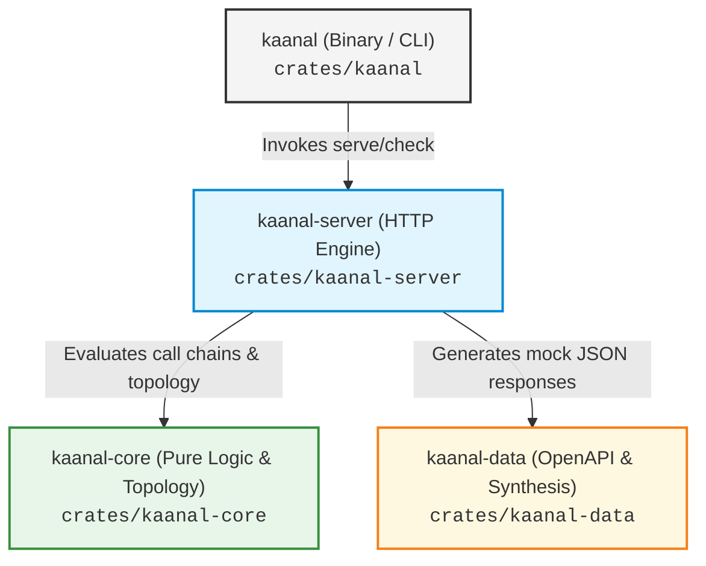
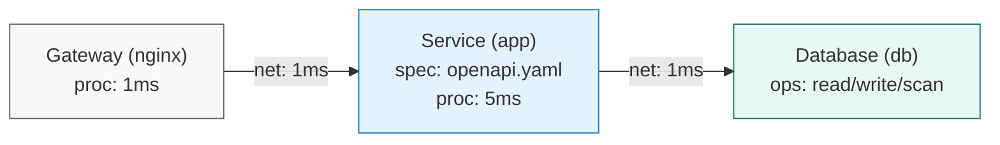
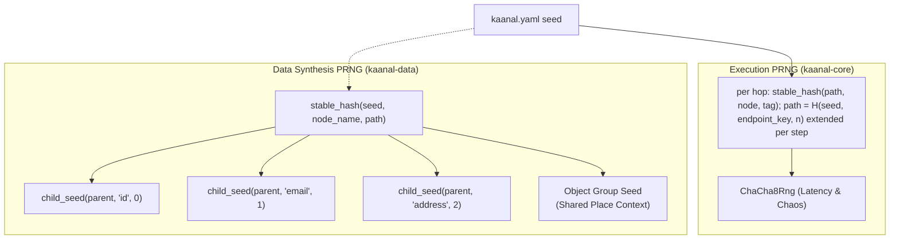
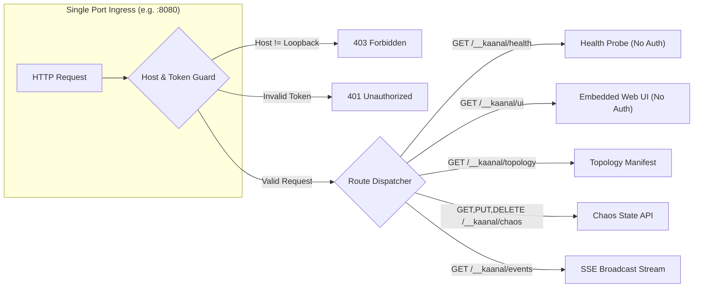
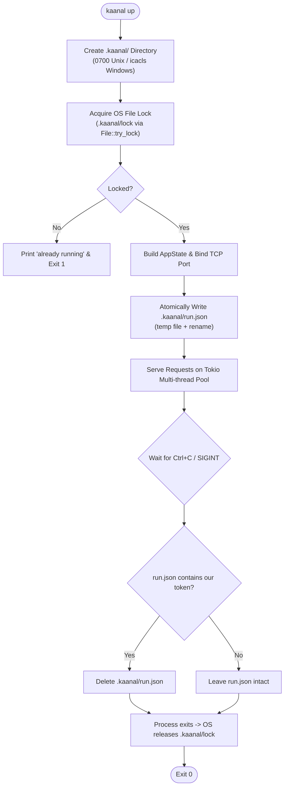

# Architecture

This document provides a comprehensive architectural breakdown of Kaanal (கானல்): its design principles, crate boundaries, execution engine, data synthesis model, control plane, security guarantees, and concurrency model.

---

## 1. Design Philosophy & Architectural Invariants

Kaanal simulates a multi-tier microservice backend using a single binary, a single configuration file (`kaanal.yaml`), and OpenAPI 3.0 specifications.

### Core Tenets

1. **One Binary, One Port**: Mock routes and the `/__kaanal/*` control plane share a single TCP port. No secondary listener or out-of-band proxy is required.
2. **Behavioral Modeling, Not Protocol Emulation**: Databases and caches are virtual nodes modeled by their operation latencies and failure probabilities. Kaanal does not execute SQL or emulate wire protocols (rule R2.8).
3. **One Cost Model, Two Drivers**: Latency calculation, distribution sampling, and failure decisions exist solely in `kaanal-core`. The live HTTP server awaits the simulated time via Tokio, while future simulators advance virtual time without changes to the cost model (rule R2.5).
4. **Pure Core Engine**: `kaanal-core` contains zero asynchronous code, zero IO, zero threads, and zero network calls. It computes outcomes deterministically given its inputs (rule R2.3).
5. **Absolute Determinism**: For a fixed `seed` in `kaanal.yaml`, identical request sequences produce identical timings, failure distributions, and response payloads.
6. **Thin Interfaces**: Every user interface (CLI, Web UI, automated test scripts) is a thin HTTP client consuming the `/__kaanal/*` control API. No interface contains business logic (rule R2.6).
7. **Fail Fast and Loud**: Invalid configurations, unparseable schemas, cyclic topologies, and illegal overrides are rejected during startup with `file:line:col` error diagnostics (rule R6.1). Kaanal never serves half-configured states.

---

## 2. Crate Decomposition & Layering

The codebase is organized into four distinct crates with a strict one-way dependency hierarchy:



### Dependency Rules and Invariants

| Crate               | Primary Role                                                                      | Prohibited Technologies                                              | Invariant                                                                                 |
| ------------------- | --------------------------------------------------------------------------------- | -------------------------------------------------------------------- | ----------------------------------------------------------------------------------------- |
| **`kaanal-core`**   | Topology graph validation, latency distributions, chain execution, FNV-1a hash.   | No `tokio`, no `axum`, no filesystem/network IO, no wall-clock time. | Pure computation only; computes outcomes, never sleeps. (Rule R2.3)                       |
| **`kaanal-data`**   | OpenAPI 3.0 parsing, `$ref` inlining, deterministic schema-driven data generator. | No dependency on `kaanal-core`, no HTTP, no async.                   | Maintains private FNV-1a hash algorithm pinned by cross-crate unit tests. (Rule R2.4)     |
| **`kaanal-server`** | Axum router, mock request handler, control API, SSE event bus, shared state.      | No CLI terminal logic, no direct argv parsing.                       | Only crate that speaks HTTP. (Rule R2.4)                                                  |
| **`kaanal-sim`**    | Discrete-event simulator: Poisson arrivals, per-node FIFO queues, virtual clock.  | No `tokio`, no IO, no timing model of its own.                       | Every service time comes from `kaanal_core::execute()`; depends on core only. (Rule R2.5) |
| **`kaanal`**        | CLI parsing via clap, directory locking, runfile management, control API client.  | No direct mock engine or database logic.                             | Thin client over control API. (Rule R2.6)                                                 |

---

## 3. Topology Compilation & Graph Invariants

Kaanal models a system as a directed graph $G = (V, E)$, compiled during startup by `Topology::build`:

- **Nodes ($V$)**:
  - `Gateway`: The single entry point of the system (exactly 1 required).
  - `Service`: Backend service hosting an OpenAPI 3.0 `spec`.
  - `Database`: Data store providing `ops` (`read`, `write`, `scan`) costs.
- **Edges ($E$)**:
  - Directed dependencies carrying network latency distributions (`net`).



### Semantic Graph Validation

During `Topology::build`, the graph is verified against strict rules:

1. **Optional Gateway**: At most one node may have `type: gateway`; with none, requests enter at the `service` or `monolith` that owns the route. More than one fails the load (rule R2.7).
2. **Edge Table** (R1.24, `callees` in the topology module): `gateway` may call `service`, `monolith`, `auth`; `service` and `monolith` may call `service`, `monolith`, `database`, `cache`, `external-api`, `auth`; `auth` may call `service`, `monolith`, `database`, `cache`, `external-api`; `database`, `cache` and `external-api` call nothing. Any other edge is rejected, naming what the caller may call. Config errors are positioned (file, line, column, node, field) by `diagnostics` on the error path only.
3. **Cycle Rejection**: The graph must be a strict DAG. Cycle detection executes an iterative depth-first search (DFS) with 3-color vertex marking (unvisited, active path, completed). Detected cycles fail with `TopologyError::Cycle` listing the cycle path (`cycle: a -> b -> a`).
4. **Reachability**: When there is a gateway, any `service` or `monolith` node specifying an OpenAPI `spec` must have an incoming edge from it. Unreachable services fail with `TopologyError::MissingGatewayEdge`.
5. **Node Attribute Affinity**: each kind is its own strict struct, so a field on the wrong kind (`ops` on a service, `spec` on a gateway) is a parse error. A `database` must end up with all three ops (its own or from a flavor preset).

---

## 4. Execution Engine & Cost Model

When a mock request arrives, Kaanal evaluates what that request experiences across the simulated architecture:

```mermaid
sequenceDiagram
    autonumber
    actor Client
    participant Router as Axum Router (matchit)
    participant Mock as Mock Handler (mock.rs)
    participant Core as Chain Executor (exec.rs)
    participant Chaos as ChaosState (RwLock)
    participant Data as Data Generator (generate.rs)
    participant Bus as SSE Broadcast Bus

    Client->>Router: GET /users/42
    Router->>Mock: Dispatched Route (its compiled endpoint: chain, op, override, error_map)
    Mock->>Chaos: Acquire Read Lock (brief)
    Mock->>Core: execute(topology, chaos, endpoint, n, chain_seed)
    Note over Core: Pure Synchronous Evaluation:<br/>1. Gateway proc (1.0ms)<br/>2. Net hop (1.0ms)<br/>3. Service proc (5.0ms)<br/>4. Net hop (1.0ms)<br/>5. DB read op (4.2ms)
    Core-->>Mock: ChainOutcome { hops, total: 12.2ms, status: Ok }
    Mock->>Mock: one tokio::time::sleep(12.2ms) for the whole chain
    Note over Mock: Shaping: failure → error_map; success → override, else generated body
    Mock->>Data: generate(schema, "response", seed=hash(seed, node, path))
    Data-->>Mock: Synthetic JSON Payload
    Mock->>Mock: apply_params(body, {"id": 42})
    Mock->>Bus: send(Event { status: 200, ms: 12.2, nodes })
    Mock-->>Client: 200 OK + X-Kaanal-Trace Header
```

### Operation Inference

The database hop operation (`Op`) is inferred from the HTTP request method and path template:

- `GET` or `HEAD` with a path parameter (e.g. `/users/{id}`) $\rightarrow$ `Op::Read` (single item lookup).
- `GET` or `HEAD` without parameters (e.g. `/users`) $\rightarrow$ `Op::Scan` (table/collection scan).
- All other HTTP methods (`POST`, `PUT`, `DELETE`, `PATCH`) $\rightarrow$ `Op::Write`.

### Latency Distribution Sampling

Node processing (`proc`), network hops (`net`), and database operations (`ops`) use `Dist`:

- **`Fixed(Duration)`**: Constant latency.
- **`LogNormal { mu, sigma, cap_ms }`**: Long-tailed distribution fitted to configured percentiles $\{p50, p99\}$:
  $$\mu = \ln(p50)$$
  $$\sigma = \frac{\ln(p99 / p50)}{Z_{99}} \quad \text{where } Z_{99} \approx 2.3263479$$
- **`Exp { mean }`**: Exponential (the queueing-theory default): $\text{mean} \times -\ln(1 - U)$ with $U$ uniform in $[0, 1)$, so $\ln(0)$ cannot occur.
- **Tail Cap Safety**: Lognormal samples are clamped to $\min(\text{sample}, 10 \times p99)$ and exponential samples to $10 \times \text{mean}$. This prevents astronomical tail samples from indefinitely hanging a request.
- **`concurrency`** (per node, optional) is not a distribution: it is a capacity for the node's own hops. `Node.concurrency` carries it to the simulator; live mode has no queues, so `AppState::build` warns and ignores it until M1.

**Second driver.** `kaanal-sim` calls the same `execute()` per simulated request and replays its hops through per-node FIFO queues (nodes with `concurrency`) on a virtual clock. At zero load its latencies equal live mode's exactly; `kaanal-sim/tests/sim.rs` pins that.

---

## 5. Live Chaos Engine & Upstream Propagation

Chaos settings live in `AppState.chaos` as an in-memory `std::sync::RwLock<ChaosState>`. Chaos is never persisted to `kaanal.yaml` and does not require server restarts.

```mermaid
flowchart LR
    subgraph Control["Control Plane"]
        CLI["kaanal chaos set"] -->|PUT /__kaanal/chaos/{node}| Guard["Security Guard"]
        UI["Web UI"] -->|PUT /__kaanal/chaos/{node}| Guard
        Guard --> Handler["set_chaos Handler"]
        Handler -->|Write Lock| State[("RwLock<ChaosState>")]
    end

    subgraph Runtime["Mock Request Pipeline"]
        MockHandler["mock::handle"] -->|Read Lock| State
        MockHandler --> Exec["kaanal_core::execute"]
        Exec --> Output["X-Kaanal-Trace & Error Status"]
    end
```

### Supported Chaos Controls

Per node, users can configure:

- `latency_ms`: Additional delay injected on every visit to that node (capped at 300,000 ms).
- `error_rate`: Probability $[0.0, 1.0]$ of failure on visit.
- `error_status`: HTTP error status code ($500 \le \text{status} \le 504$).
- `down`: Hard outage flag ($100\%$ failure with HTTP 503).

### Invariant: Unconditional Random Draws

To ensure determinism (rule R4.1), **the chaos error roll is always drawn from the RNG**, regardless of whether chaos is currently configured on that node. If the draw were skipped when chaos was inactive, enabling chaos would shift all subsequent PRNG draws, altering downstream latencies and body seeds. Drawing unconditionally guarantees that timing sequences remain identical across test runs.

### Failure Cascading & Tracing

When a downstream node fails (e.g., database error 504):

1. The execution chain terminates immediately at that hop.
2. The overall request adopts that node's error status.
3. Total delay includes all hops executed up to and including the failed node.
4. The response includes `X-Kaanal-Trace` ending in `node.error=STATUS` (e.g. `nginx.proc=1.0ms,net=1.0ms,app.proc=5.0ms,net=1.0ms,db.error=504`).

---

## 6. Deterministic Data Synthesis Engine

Response bodies are synthesized by `kaanal-data` using response schemas declared in OpenAPI 3.0 files.



### Seeding Invariants

- **Endpoint Seed Independence (Rule R4.4)**: Each generated property derives its seed via:
  $$\text{child\_seed} = \text{stable\_hash}(\text{parent\_seed}, \text{field\_name}, \text{index})$$
  Adding, removing, or reordering schema properties never alters the generated values of sibling properties.
- **Geographic Coherence**: All address components (`city`, `state`, `pincode`, `street`) in a single JSON object sample a shared `group` seed derived from the enclosing object. A generated object never mixes a Mumbai pincode with a Chennai city.
- **Formats Beat Lengths (Rule R4.5)**: Standard formats (`uuid`, `email`, `date-time`, `ipv4`, `uri`) and well-formed heuristic fields are never truncated by `maxLength` or padded by `minLength`. A truncated email is invalid; well-formed formatting takes precedence.
- **URL Parameter Binding**: Path parameters (e.g., `/users/{id}` called as `/users/42`) overwrite matching schema properties via `apply_params`, safely coercing numeric types without crashing on non-numeric strings.

---

## 7. Control Plane, Security & Event Bus

The control plane exposes operational endpoints under `/__kaanal/*`:



### Security Guard Architecture

The `guard` middleware executes before any axum request extractor:

1. **Host Header Verification (DNS Rebinding Guard, Rule R5.3)**: `Host` must match `localhost`, `127.0.0.1`, or `[::1]`, optionally followed by the exact bound port. Requests targeting attacker domains resolving to loopback are rejected with 403.
2. **Bearer Token Authentication (Rule R5.2)**: All control routes (except `health` and `ui`) require `Authorization: Bearer <token>`. Comparisons use `constant_time_eq` to prevent timing attacks.
3. **Query Parameter Token Exemption**: `?token=<token>` is accepted exclusively on `GET /__kaanal/events` because standard browser `EventSource` cannot set custom headers.
4. **CORS Boundary (Rule R5.4)**: `Access-Control-Allow-Origin: *` is set exclusively on mock routes. Control endpoints never emit CORS headers, preventing rogue websites from manipulating chaos.
5. **Security Response Headers**: Every control response carries `Cache-Control: no-store` and `X-Content-Type-Options: nosniff`.

---

## 8. Embedded Web UI Architecture

Served at `/__kaanal/ui`, the Web UI is a self-contained single-page dashboard embedded directly into the binary via `include_str!`:

- **Zero Assets, Zero Build Step**: Vanilla HTML, CSS, and modern JavaScript.
- **Fragment Token Transport**: The access token is read strictly from the URL fragment (`#__kaanal/ui#token=...`). Browsers never transmit URL fragments to servers, keeping the token out of server access logs.
- **XSS Immunity**: The UI constructs dynamic DOM nodes exclusively via `element.textContent`, never `innerHTML` or `eval()`.
- **Content Security Policy (CSP)**: Served with `default-src 'none'; script-src 'unsafe-inline'; style-src 'unsafe-inline'; connect-src 'self'; frame-ancestors 'none'`.
- **Bounded Resource Usage**: Real-time traffic rate (rps) and error percentages (err%) use fixed-size 10-second bucket counters, ensuring memory usage remains constant under high request rates.

---

## 9. Process Lifecycle & Concurrency Model



### Single Instance Enforcement

- **OS File Lock (Rule R6.7)**: `kaanal up` opens `.kaanal/lock` and calls `std::fs::File::try_lock()` (Rust 1.89+). If another instance holds the lock, it immediately exits with code 1.
- **Crash Safety**: Operating system file locks are released by the kernel upon process termination. Stale lock files never occur after abnormal termination or `kill -9`.
- **Atomic State Persistence**: Server metadata (`port`, `token`, `pid`) is written to `.kaanal/run.json` via a temporary file and atomic rename.

---

## 10. System Invariants & 3 AM Failure Modes

| Potential Failure Mode                 | Root Cause                                                     | Kaanal Defense-in-Depth                                                                                 |
| -------------------------------------- | -------------------------------------------------------------- | ------------------------------------------------------------------------------------------------------- |
| **DNS-Rebinding Attack**               | Malicious website scripts browser to query `127.0.0.1:8080`.   | `guard` middleware checks `Host` header against loopback whitelist; rejects foreign hosts with 403.     |
| **Cross-Origin Chaos Manipulation**    | Browser tries to send preflight or POST to `/__kaanal/chaos`.  | CORS headers are strictly disabled on the control plane. Options preflights fail.                       |
| **RNG Desynchronization**              | Toggling chaos causes subsequent timings or payloads to shift. | Chaos error rolls are drawn unconditionally on every request, preserving downstream PRNG sequence.      |
| **Recursive `$ref` Memory Exhaustion** | Circular OpenAPI schema causes unbounded recursion.            | `ApiModel::from_openapi` tracks traversal stack and enforces a 10,000 reference expansion budget.       |
| **Race Conditions During Startup**     | Two terminal sessions launch `kaanal up` simultaneously.       | OS file lock on `.kaanal/lock` guarantees exactly one winner; loser fails cleanly with code 1.          |
| **Token Leakage via Proxy / Redirect** | CLI tool obeys `HTTP_PROXY` or follows malicious redirects.    | CLI `ureq` client explicitly disables system proxies and redirects.                                     |
| **Token Compromise in Logs**           | Token passed via query string appears in server or proxy logs. | Query string tokens are rejected everywhere except `/__kaanal/events`. UI reads token from `#fragment`. |
| **Port Clashing**                      | Configured port is already occupied by another service.        | Server automatically probes `port..=port+20`, binding the first available socket.                       |
