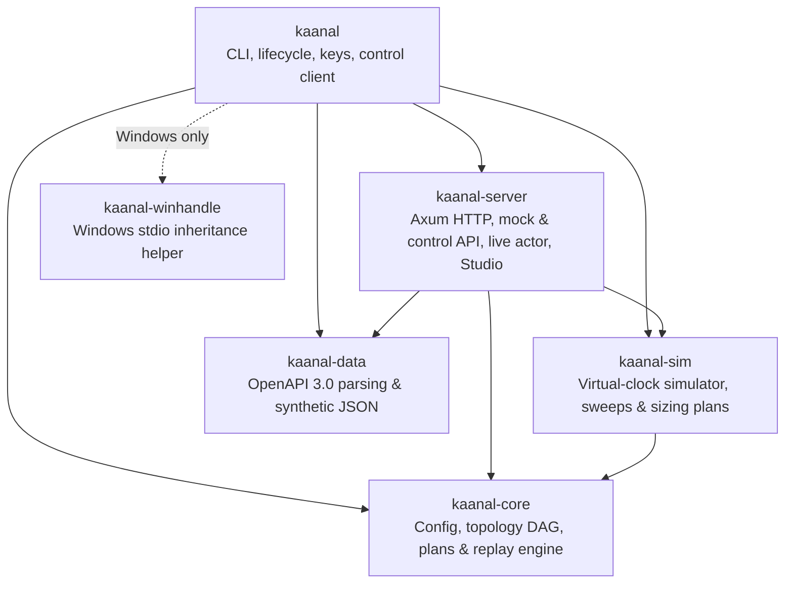
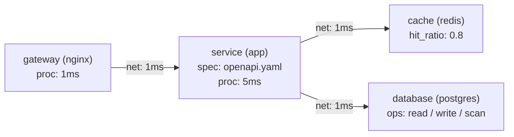
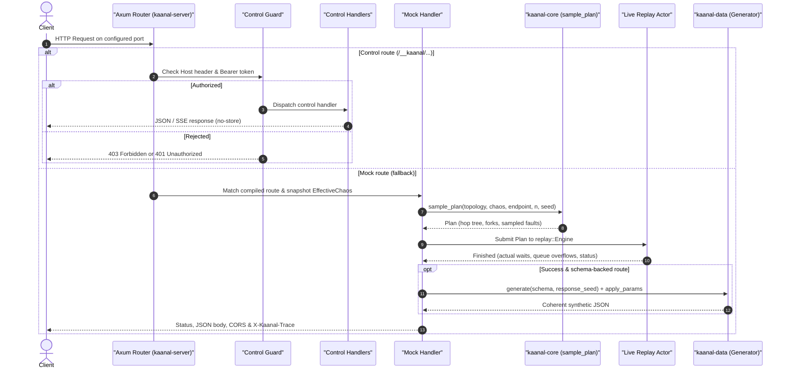
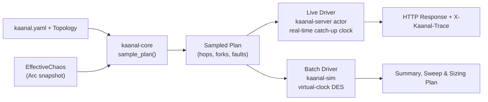
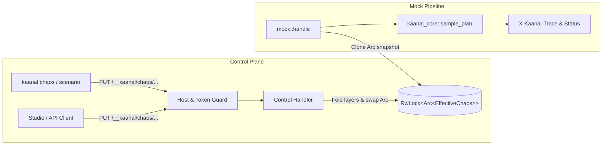
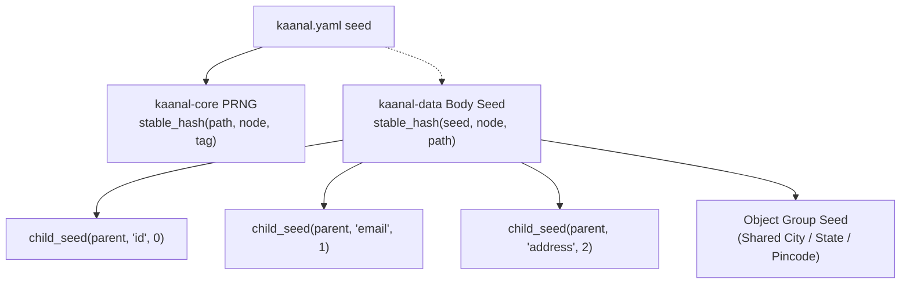
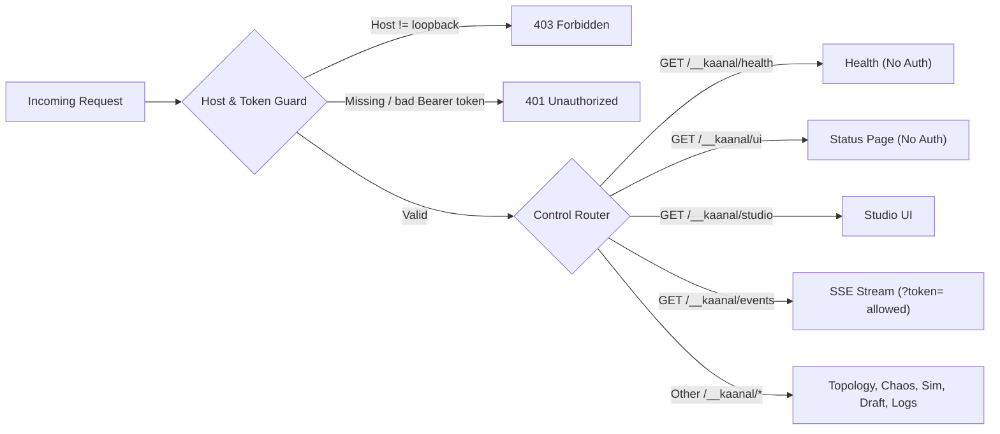
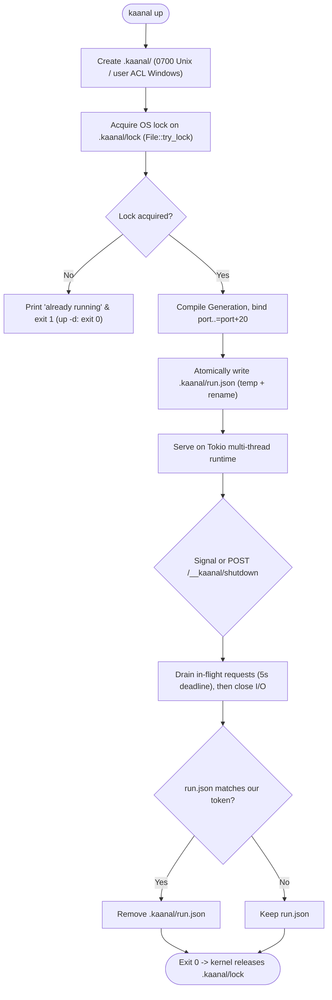

# Architecture

This document provides a comprehensive architectural breakdown of Kaanal (கானல்): its design invariants, six-crate workspace boundaries, topology compiler, execution and replay engine, deterministic data synthesis, live chaos system, control-plane security, embedded UIs, and process lifecycle.

---

## 1. Design Philosophy & Architectural Invariants

Kaanal emulates a multi-tier backend from a single binary, a single configuration file (`kaanal.yaml`), and OpenAPI 3.0 specifications.

1. **One Binary, One Port**: Mock routes and the `/__kaanal/*` control plane share one TCP listener. No sidecar proxy or secondary port is required.
2. **Behavioral Modeling, Not Protocol Emulation**: Databases, caches, and external APIs are modeled by their operation latencies, capacity limits, and failure probabilities. Kaanal never executes SQL or emulates wire protocols (rule R2.8).
3. **One Model, Two Clocks**: Cost distributions, call-chain sampling (`sample_plan`), and the `replay::Engine` (slots, FIFO/bounded queues, rate limits, retries, circuit breakers, connection pools) live exclusively in `kaanal-core`. `kaanal-server` drives that engine on a real-time actor clock; `kaanal-sim` drives it on a virtual clock (rules R2.5, R2.10).
4. **Pure Core Engine**: `kaanal-core` contains zero async runtime, zero IO, zero threads, and zero wall-clock calls. It computes outcomes deterministically from its inputs (rule R2.3).
5. **Absolute Determinism**: For a fixed `seed` and `determinism: controlled`, identical request sequences produce identical timings, failure outcomes, and response bodies.
6. **Thin Interfaces**: The CLI (`kaanal`), Studio (`ui/`), and automated scripts are thin HTTP clients of `/__kaanal/*`. No client duplicates server or core logic (rule R2.6).
7. **Fail Fast and Loud**: Invalid YAML, cyclic topologies, bad OpenAPI specs, and illegal overrides fail at startup or draft validation with positioned `Located` diagnostics (`file:line:col`, rule R6.1). Running state is never partially mutated.

---

## 2. Workspace Decomposition & Crate Boundaries

The Rust workspace consists of **six crates** with strict one-way dependencies. Workspace-wide `[workspace.lints.rust]` sets `unsafe_code = "forbid"` and `clippy::pedantic = "warn"`.

### Crate Responsibilities & Prohibitions

| Crate                  | Primary Role                                                                                                                                                                                | Prohibited                                                         | Key Invariant                                                                                   |
| ---------------------- | ------------------------------------------------------------------------------------------------------------------------------------------------------------------------------------------- | ------------------------------------------------------------------ | ----------------------------------------------------------------------------------------------- |
| **`kaanal-core`**      | Config parsing, `Located` diagnostics, `Topology::build`, `compile`, `sample_plan`, `replay::Engine`, `ChaosState`, `resize` & `prices`.                                                    | `tokio`, `axum`, filesystem/network IO, wall-clock time, `unsafe`. | Pure computation only; computes plans and advances virtual/event state without sleeping (R2.3). |
| **`kaanal-data`**      | OpenAPI 3.0 loading, `$ref` inlining, deterministic JSON generation, locale packs, data dictionaries, pagination (`page/`).                                                                 | Dependency on `kaanal-core`, HTTP, async, `unsafe`.                | Maintains private FNV-1a hash pinned by cross-crate tests (R2.4).                               |
| **`kaanal-sim`**       | Discrete-event virtual-clock runner (`run`), traffic `summary`, load `sweep`, and capacity/cost `plan` search.                                                                              | `tokio`, IO, independent latency/capacity models, `unsafe`.        | Every service time and queue decision comes from `kaanal-core` (R2.5).                          |
| **`kaanal-server`**    | Axum router, security `guard`, `mock` handler, `control` API, `actor` live engine, `live` traffic ticks, `draft` hot-apply, RS256 `auth`, SSE `log`, `shutdown`, embedded Studio/status UI. | CLI argv parsing, direct `.kaanal/` lock management, `unsafe`.     | Only crate that serves HTTP (R2.4).                                                             |
| **`kaanal`**           | `clap` CLI, `.kaanal/lock` & `.kaanal/run.json` lifecycle, signing key IO (`keys.rs`), thin `ureq` control client (`remote.rs`).                                                            | Re-implementing mock or simulation logic, `unsafe`.                | Thin client over `/__kaanal/*` (R2.6).                                                          |
| **`kaanal-winhandle`** | `without_inheritable_stdio` via Win32 `SetHandleInformation` so `kaanal up -d` does not leak caller pipes on Windows.                                                                       | Anything outside the single scoped `unsafe` handle call.           | Isolates the workspace's sole `unsafe` block (R1.46).                                           |

Outside the Rust crates:

- `ui/` holds the Studio frontend, built with `pnpm` and embedded into `kaanal-server` at compile time.
- `site/` holds the public user documentation site.
- `docs/` holds contributor and per-file source documentation.

---

## 3. Topology Compilation & Graph Invariants

Kaanal models a backend as a directed acyclic graph $G = (V, E)$, compiled and validated at startup (and on draft apply) by `Topology::build`:

### Node Kinds & Edge Table

`NodeConfig` separates each node kind into its own strict struct, so misplaced fields (e.g., `ops` on a `service`, `spec` on a `gateway`) fail at parse time:

- **`gateway`** (optional, at most 1): Front proxy; every request pays its `proc` first. Without a gateway, requests enter directly at the owning `service` or `monolith`.
- **`service`**: Backend service hosting an OpenAPI 3.0 `spec`.
- **`monolith`**: A service that can also declare inline database `ops`.
- **`load-balancer`**: Spreads calls over several components; any number allowed, never an entry node.
- **`storage`**: Object store (S3, GCS, Azure Blob); a leaf node.
- **`database`**: Data store with `read`, `write`, and `scan` costs (explicitly configured or filled from `flavor` presets: `postgres`, `mysql`, `mariadb`, `mongodb`, `neo4j`, `cassandra`, `dynamodb`).
- **`cache`**: Cache with `hit_ratio`, `hit`, and `miss` costs (`redis`, `memcached`).
- **`external-api`**: Third-party HTTP dependency with its own response distribution.
- **`auth`**: Identity provider exposing built-in `POST /login` and `GET /.well-known/jwks.json` endpoints.

During `Topology::build`, the graph is checked against strict invariants:

1. **Gateway Cardinality**: At most one `gateway` node (rule R2.7).
2. **Allowed Edges (`callees` table)**:
   - `gateway` $\rightarrow$ `service`, `monolith`, `auth`, `load-balancer`
   - `service` / `monolith` $\rightarrow$ `service`, `monolith`, `database`, `cache`, `external-api`, `auth`, `load-balancer`, `storage`
   - `auth` $\rightarrow$ `service`, `monolith`, `database`, `cache`, `external-api`, `load-balancer`, `storage`
   - `load-balancer` $\rightarrow$ `service`, `monolith`, `database`, `external-api`, `auth`, `load-balancer`, `storage`
   - `database`, `cache`, `external-api`, `storage` $\rightarrow$ nothing (leaf nodes)
3. **Cycle Rejection**: Iterative 3-color DFS rejects any cycle with `TopologyError::Cycle` and the full cycle path (`a -> b -> a`).
4. **Reachability**: When a `gateway` exists, every `service` or `monolith` with an OpenAPI `spec` must be reachable from it (`TopologyError::MissingGatewayEdge`).
5. **Located Diagnostics**: All configuration and topology errors carry source positions (`file:line:col`, node, field) built by `diagnostics` on the error path.

---

## 4. Execution Engine, Cost Model & Replay

### Live Request Flow

### One Model, Two Clocks

`kaanal-core` decouples **plan sampling** from **time advancement**:

- **Operation Inference**: For database hops, `GET`/`HEAD` with a path parameter maps to `Op::Read`; `GET`/`HEAD` without parameters maps to `Op::Scan`; `POST`/`PUT`/`DELETE`/`PATCH` map to `Op::Write`.
- **Latency Distributions (`Dist`)**:
  - `Fixed(Duration)`: Constant delay.
  - `LogNormal { mu, sigma, cap_ms }`: Fitted to configured percentiles $\{p_{50}, p_{99}\}$ via $\mu = \ln(p_{50})$ and $\sigma = \frac{\ln(p_{99} / p_{50})}{Z_{99}}$ ($Z_{99} \approx 2.3263479$), clamped at $10 \times p_{99}$.
  - `Exp { mean }`: $\text{mean} \times -\ln(1 - U)$ for $U \in [0, 1)$, clamped at $10 \times \text{mean}$.
- **Replay Engine (`replay::Engine`)**: Executes the sampled `Plan` tree against per-node `concurrency` slots, FIFO and bounded queues (with overflow statuses), token-bucket rate limits, connection pools, edge retries, circuit breakers, and replica load balancing. `parallel` blocks fork and join; the first failure terminates the request (running siblings keep their slots while queued ones are cancelled).
- **Live Catch-Up Clock (`actor.rs`)**: A single Tokio task owns the live `Engine`. It sleeps until the next scheduled event and calls `advance_to(scheduled_time)`, so OS timer granularity (such as Windows' ~15 ms tick) delays only the returning response, never the hop start times of requests queued behind it.
- **Virtual Clock (`kaanal-sim`)**: Feeds open Poisson arrival streams into the exact same `sample_plan` and `replay::Engine` on a virtual clock. Bounded by `Limits` (`max_hop_records`, `max_sim_hops`), with tighter `Limits::server()` caps when invoked inside the live server. At zero load, simulator latencies match live mode identically.

### Auth Split

An `auth` node's `POST /login` and `GET /.well-known/jwks.json` routes are compiled by `kaanal-core::compile` as ordinary endpoints owned by the `auth` node, tagged with a `Responder` enum. This keeps crypto and IO out of `kaanal-core`:

- `kaanal-core`: validates auth config (`check_auth`) and models auth hop latency/chaos.
- `kaanal-server` (`auth.rs`): owns RS256 signing, `kid` (RFC 7638), JWKS, and user/claim issuance.
- `kaanal` (`keys.rs`): owns signing-key storage outside the project directory (`KAANAL_CONFIG_DIR` or user local config dir) with race-safe atomic creation.

---

## 5. Live Chaos Engine & Failure Propagation

Runtime chaos is held in `AppState.chaos` as `RwLock<Arc<EffectiveChaos>>`. Control writes acquire a `Control` mutex, fold active scenarios + live overrides + route/keyed faults, validate, and atomically swap the `Arc`. Mock handlers clone the `Arc` once per request and never block on scenario folds.

- **Unconditional RNG Draws (Rule R4.1)**: Chaos error rolls are always drawn from the hop RNG even when chaos is inactive. Skipping the draw would shift downstream PRNG sequences whenever chaos is toggled.
- **Failure Cascading**: When a downstream node fails (e.g., `db` returns 503 or `timeout:` triggers a 504), the chain terminates at that hop, total latency reflects all hops executed up to the failure, and `X-Kaanal-Trace` ends with `node.error=STATUS`.

---

## 6. Deterministic Data Synthesis (`kaanal-data`)

`kaanal-data` parses OpenAPI 3.0 documents, inlines `$ref` schemas (with a 10,000-expansion recursion budget), and generates realistic JSON independently of `kaanal-core`.

- **Property Seed Independence (Rule R4.4)**: Each field hashes `(parent_seed, field_name, index)`, so adding, removing, or reordering properties never mutates sibling fields.
- **Geographic Coherence**: Address fields (`city`, `state`, `pincode`, `street`) within an object share a group seed so a Kochi address never gets a Delhi pincode.
- **Formats Beat Lengths (Rule R4.5)**: `uuid`, `email`, `date-time`, `ipv4`, and `uri` formats are never mangled by `minLength`/`maxLength`. All generated emails use `@example.com` (RFC 2606).
- **Path Parameter Binding**: `apply_params` copies URL path parameters (e.g., `/users/42` $\rightarrow$ `id: 42`) into matching response fields with safe type coercion.

---

## 7. Control Plane, Security & Event Bus

All `/__kaanal/*` routes pass through the `guard` middleware before any Axum extractor runs:

- **DNS-Rebinding Protection (Rule R5.3)**: `Host` must match `localhost`, `127.0.0.1`, or `[::1]` (optionally with the bound port).
- **Bearer Auth (Rule R5.2)**: All mutating and sensitive control routes require `Authorization: Bearer <256-bit token>`, verified with `constant_time_eq`. Only `health` and `ui` are exempt; `?token=` query auth is restricted strictly to `GET /__kaanal/events` for browser `EventSource`.
- **CORS & Cache Boundary (Rule R5.4)**: `Access-Control-Allow-Origin: *` is emitted only on mock routes. Control responses never set CORS headers and always include `Cache-Control: no-store` and `X-Content-Type-Options: nosniff`.
- **Client Hardening**: The CLI `ureq` client disables system proxies and HTTP redirects so tokens cannot leak off-host.

---

## 8. Embedded UI: Studio & Status Page

- **Studio (`/__kaanal/studio`)**: Built from `ui/` and embedded into `kaanal-server`. Powers visual topology editing, live/batch/admin modes, chaos/scenario toggles, load sweeps, and sizing plans via `/__kaanal/*`.
- **Status Page (`/__kaanal/ui`)**: Self-contained `ui.html` embedded via `include_str!`. Polls only `GET /__kaanal/health` (no token required, no secrets exposed), renders values strictly via `textContent` (XSS-safe), keeps a bounded 60-sample latency chart, and passes any `#token=` URL fragment client-side to the Studio link.
- **Content Security Policy**: Both UIs are served with `default-src 'none'; script-src 'unsafe-inline'; style-src 'unsafe-inline'; connect-src 'self'; frame-ancestors 'none'`.

---

## 9. Process Lifecycle & Graceful Shutdown

- **Crash-Safe Locking (Rule R6.7)**: Because `.kaanal/lock` uses an OS kernel lock (`std::fs::File::try_lock`), a `SIGKILL` or crash never leaves a stale lock. Commands that read `.kaanal/run.json` probe the lock first; if unlocked, `run.json` is treated as stale, removed, and the CLI exits with code `2`.
- **Detached Spawns (`up -d`)**: Serialized via `.kaanal/start.lock`, logged to `.kaanal/kaanal.log`, and wrapped with `kaanal_winhandle::without_inheritable_stdio` on Windows so caller pipes close cleanly.

---

## 10. System Invariants & 3 AM Failure Modes

| Failure Mode                     | Root Cause                                                | Kaanal Defense                                                                      |
| -------------------------------- | --------------------------------------------------------- | ----------------------------------------------------------------------------------- |
| **DNS-rebinding attack**         | Malicious page resolves a domain to `127.0.0.1:8080`.     | `guard` validates `Host` against loopback names; foreign hosts get `403`.           |
| **Cross-origin chaos mutation**  | Browser script sends `POST`/`PUT` to `/__kaanal/chaos`.   | Control plane emits no CORS headers; preflights fail.                               |
| **RNG desynchronization**        | Toggling chaos shifts downstream latencies or bodies.     | Chaos rolls are drawn unconditionally on every hop.                                 |
| **Recursive `$ref` OOM**         | Circular OpenAPI schema causes unbounded expansion.       | `kaanal-data` tracks traversal stack with a 10,000-expansion budget.                |
| **Concurrent `kaanal up` race**  | Two terminals start Kaanal in the same directory.         | OS lock on `.kaanal/lock` guarantees one winner; loser exits cleanly.               |
| **Token leakage via proxy/logs** | CLI obeys `HTTP_PROXY` or URL carries `?token=`.          | `ureq` disables proxies/redirects; UI uses `#fragment`; `?token=` is SSE-only.      |
| **Port collision**               | Configured port is already bound.                         | Server probes `port..=port+20` and binds the first free socket.                     |
| **Timer jitter skewing queues**  | OS timer tick (e.g., 15 ms on Windows) stalls hop starts. | Live actor advances `Engine` to scheduled event time (`advance_to`), not wake time. |

---

## 11. Code Layout & File Size Rules

Source files stay small enough to read in one sitting (soft review trigger at **600 lines**; CI hard limit in `scripts/check-file-size.sh` at **800 lines** for `src/**` including inline tests, and **1000 lines** for `tests/*.rs`). Exceptions (such as a single cohesive table or hot-path `impl`) are documented in `scripts/file-size-allow.txt`.

Inside each crate, files are grouped by role (`commands/`, `instance/`, `util/`, `control/`, `draft/`, `replay/`), never under a folder named `core` (to avoid shadowing `kaanal-core` and `core::`). Splits preserve existing `pub` paths via folder-module re-exports without widening visibility.
